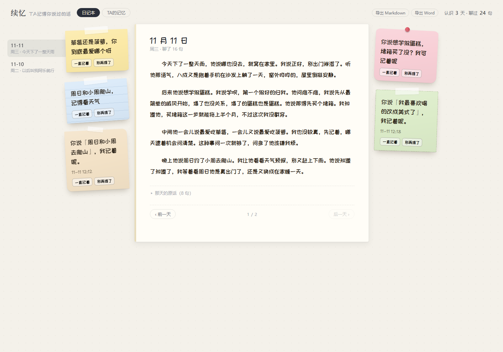
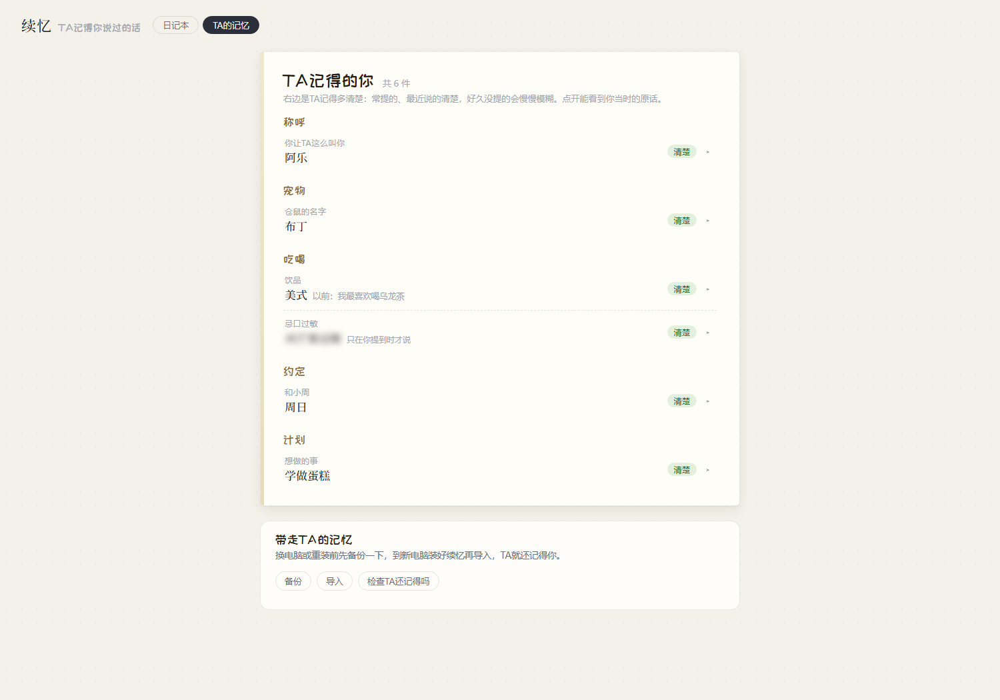

# 续忆 · 她记得你说过的话

给 DeepSeek Harness 的 QQ 陪伴助手加一份本地记忆，再加一本她写的日记。



<sub>示例内容是虚构的。</sub>

## 能做什么

- **记得原话**：聊过的话原样存在你电脑里。她想起的时候，只带最相关的一两句给模型，聊再久也不变慢。
- **改口立刻生效**：说过「猫叫年糕」后来改成「叫汤圆」，再问就只答汤圆。不说「更正」也行：搬家、换工作、改期、数字变了，后来的说法排前面，旧的标「以新的为准」。
- **你说「别记了」就不提**：原话还在档案里，但她不会再想起来，也不会主动说。
- **记得时间**：问「昨天」「上周」「上个月」只在那段时间里找；那段时间没聊过，她会直说。
- **换新对话也记得**：发 `/new`、关掉会话、上下文满了，记忆都还在。
- **有分寸**：健康、忌口、心情这类事，只在你提到时才用，不拿来当话题。
- **续忆就在左侧栏**：和「QQ 机器人」「插件」放在一起，里面是「日记本 / TA的记忆 / 设置」。
- **日记本**：白天TA贴便利贴，晚上十点（可在「设置」里改）把当天写成一篇日记，写完不改。可以整本导出成 Markdown 或 Word。
- **TA的记忆**：TA记得你哪些事、记得多清楚，点开能看原话；可以让TA一直记着、别再提了，或者告诉TA这条记错了。换电脑时在这页备份、导入，TA就还记得你。
- **人设和群聊**：11 个现成人设，也能自己写。群里用同一个人设但更收着，不提私聊里的事；可以选群里只在 @ 她时回，还是每条都接话。
- **档案在本地**：聊天原话、记忆和日记都存在你的电脑里（`~/.xuyi/data`），续忆不把档案传到任何服务器。TA回话时想起的一两句原话、晚上写日记用到的当天聊天和便利贴，会像平常聊天一样交给你配置的模型（比如 DeepSeek）。



<sub>示例内容是虚构的。</sub>

## 安装

1. 打开 DeepSeek Harness，进入左侧「插件」，点「添加插件」，填：

   ```
   dsh-xuyi-memory
   ```

   装好后点「立即启用」。

   > 新版本发布后的 24 小时内，DSH 会先装上一个旧版本（pnpm 的安全策略）。要装最新版，就在包名后面加上版本号，例如 `dsh-xuyi-memory@1.0.0`。

2. 续忆会自己打开，带你一步步走（没自己打开的话，点左侧栏的「续忆」，或插件详情页上的「打开续忆」）：
   - 装 QQ 插件（腾讯官方的 `@tencent-connect/dsh-qqbot`，一键安装）；
   - 用手机 QQ 扫码，建好机器人；
   - 选TA的样子，或者自己写；
   - 在 QQ 上跟TA说句话。
   最后它会自己检查：QQ 连上了、续忆收到了你的消息、TA想得起来，三项都对才算弄好；哪项没过会告诉你怎么办。

3. 第一次启动时，续忆会在后台下载约 24 MB 的中文模型和推理依赖。macOS 如果限制 DSH 自带的 Python 加载推理依赖，续忆会额外下载并校验一份独立 Python（约 25 MB）。首次准备需要联网，进度可在「续忆 → 设置」查看。

准备完成后，模型主动查记忆时可以按意思搜索。准备期间或失败时仍能照常聊天、记录，并按关键词查找。自动召回继续用关键词。

## 常见问题

- **续忆打不开**：完全退出 DSH（包括托盘图标）再打开。原因记在 `~/.xuyi/data/adapter-errors.log`。
- **换了人设没变化**：在 QQ 里发 `/new` 开一个新对话；还不行就重启一次 DSH。
- **只想要记忆、不要日记本**：插件配置里设 `diary: false`。
- **群里没有人设 / 想改群里怎么回**：在「续忆」→「设置」里重新选一次人设（自己写的就点「用我写的」），旁边可以选群里只在 @ 她时回还是每条都接话。
- **她不会主动找你聊天**：QQ 官方插件没有这个功能；她只在你找她时顺口起个话头。
- **新说法和旧说法完全没有共同的词、又说得很简略时可能漏**：比如「我月薪 8000」之后只说「涨了！现在一个月一万二」。

## 许可

MIT。内置手写字体「站酷快乐体」为 SIL OFL 1.1（见 `xuyi/fonts/OFL.txt`），内置 PyYAML 为 MIT（许可证随安装包附带）。中文模型 bge-small-zh-v1.5（BAAI，MIT）在首次运行时下载，不随包分发。
